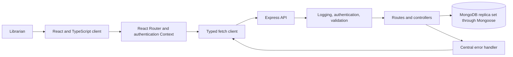
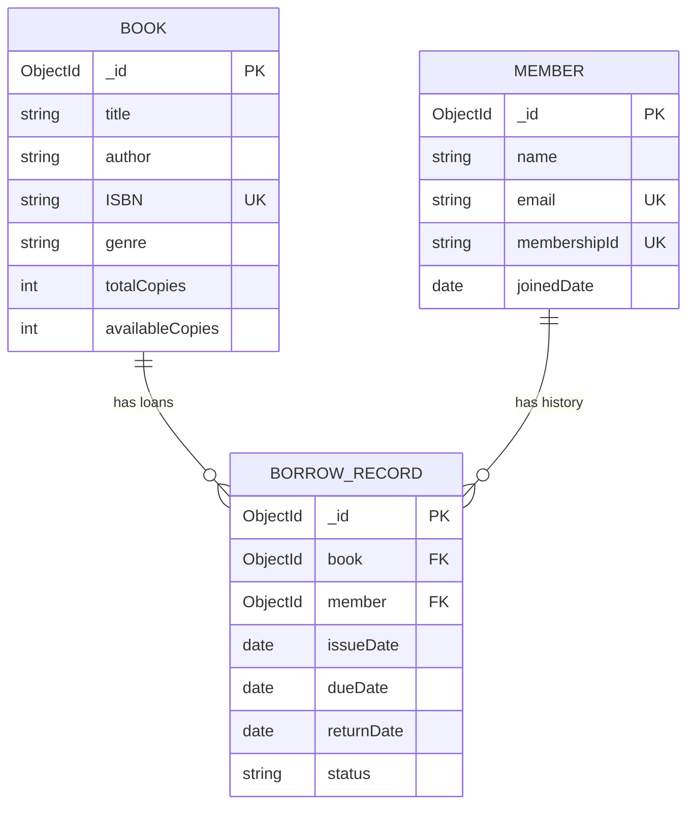
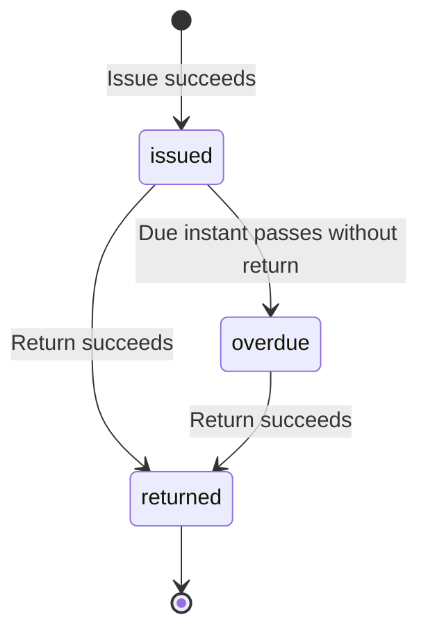
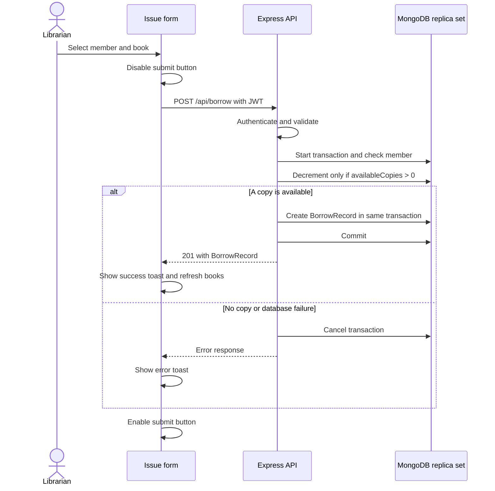

# ShelfLife implementation guide

## 1. Assumptions and scope

The exam specifies the required entities, endpoints, screens, and design questions.
This guide supplies the contracts needed for an end-to-end build.
These contracts are implementation assumptions, unless the coverage table identifies an exam requirement.

| Decision | Implementation assumption |
|---|---|
| Build target | One college library; one Express service; one React application |
| Backend language | TypeScript, with Node.js, Express, and Mongoose |
| Frontend tool | Vite with React and TypeScript |
| Loan period | 14 days; server calculates dates in UTC |
| Due date comparison | An unreturned loan is overdue when `dueDate` is earlier than the current UTC instant |
| Copy counts | New books start with `availableCopies = totalCopies` |
| Librarian accounts | Seed one librarian; omit public librarian registration |
| Authentication | JWT with a one-hour lifetime and librarian role |
| Token storage | Authentication Context plus `sessionStorage`; clear both on logout or HTTP 401 |
| Private reads | Protect member selection and history because they contain member information |
| Supporting routes | Add `GET /api/members` and `GET /api/books/genres` for selection controls |
| Title search | Add optional `q` to book listing; search all matching books before pagination |
| History | Return all records, newest first; include the referenced book and member summaries |
| Return retry | Return HTTP 409 for an already returned loan; never increment copies twice |
| Additional UI | Add small book and member creation forms; add a Return button to member history |
| Scale scope | Describe 500 campuses, approximately 2 million members, and 10× traffic in Q3 |

The token storage choice is suitable for the assessment.
Use HTTPS and prevent script injection.
Evaluate secure cookie authentication before a public production release.

Do not add a maximum loan count or block repeated borrowing unless the examiner requires it.
The specification does not define those policies.

### Additions made during the backend build

These items are not in the exam specification. Each one resolves a gap in this guide.

| Addition | Reason |
|---|---|
| `backend/src/config.ts` | Reads the environment one time; stops startup when a required variable is missing |
| `backend/src/db.ts` | Shared connection and transaction helper for the server, the seed, and the test |
| Node.js runs `.ts` files directly | Removes a separate runner; `npm run build` still compiles to `backend/dist/src/` |
| Genre normalization | Stores one spelling per genre, for example `science fiction` becomes `Science Fiction` |
| Title sort without letter case | Uses an `en` collation of strength 2 for the book sort and its indexes |
| HTTP 429 `RATE_LIMITED` | Login accepts 10 attempts for each client address in one minute; in-memory limit |
| HTTP 413 `PAYLOAD_TOO_LARGE` | Reports a JSON body above 32 KB |
| HTTP 500 on an impossible return | A return cancels when the book is missing or its count is already full |
| Seed librarian password | A repeated seed applies the current password from `backend/.env` |
| `{ member: 1, issueDate: -1, _id: -1 }` index | Adds the `_id` tie-breaker to the specified history index |
| Extra test cases in `borrowing.test.ts` | Authentication, validation, uniqueness, listing, and history acceptance rows |

### Technical terms

| Term | Meaning in this project |
|---|---|
| Issue | Lend one available book copy to a member |
| Return | Close one loan and restore one available copy |
| Loan | One `BorrowRecord` document |
| Transaction | A database operation that commits all related writes or cancels all related writes |
| JWT | A signed token used to identify a logged-in librarian |
| Reference | A MongoDB ObjectId that identifies another document |
| DTO | A JSON object sent between the backend and frontend |
| TTL | The time after which a cache entry expires |
| Shard | One database partition in the university network design |
| Campus | One library boundary in the university network design |

## 2. Requirement coverage

Use this table as the final submission checklist.
Each row must have code, verification evidence, or the required written answer.

| ID | Exam requirement | Planned implementation or answer | Acceptance evidence |
|---|---|---|---|
| G1 | Attempt all three questions for one application | `backend/`, `frontend/`, system design answer | Shared entities and API contracts |
| G2 | Clean code, indentation, names, comments | All source files | Format review; transaction comments |
| G3 | State assumptions at the top | README and both guides | Assumption sections remain visible |
| G4 | Separate labeled deliverables | README submission table | All listed files exist |
| Q1a | Book schema and all six fields | `models/Book.ts` | Required strings; copy limits; unique ISBN |
| Q1a-M | Member schema and all four fields | `models/Member.ts` | Required fields; unique email; valid date |
| Q1a-B | BorrowRecord schema and all seven fields | `models/BorrowRecord.ts` | References; dates; status enum |
| Q1b-1 | `POST /api/books` | Book route and controller | HTTP 201; duplicate ISBN gives 409 |
| Q1b-2 | `GET /api/books`, pagination, genre | Book route and controller | Correct total, pages, and filter |
| Q1b-3 | `POST /api/members` | Member route and controller | HTTP 201; duplicate email gives 409 |
| Q1b-4 | `POST /api/borrow` | Transaction in borrow controller | One decrement and one new loan |
| Q1b-5 | `POST /api/return/:borrowId` | Transaction in borrow controller | Return date; status; one increment |
| Q1b-6 | `GET /api/members/:id/history` | Member controller | Complete history with references |
| Q1c-1 | Centralized error handling | `middleware/errorHandler.ts` | Consistent JSON; no stack exposure |
| Q1c-2 | Request logging | `middleware/requestLogger.ts` | Method, path, status, elapsed time |
| Q1c-3 | Input validation | `middleware/validate.ts` | Invalid body, query, and ID give 400 |
| Q1d-1 | Login route issues JWT | Auth controller | Valid credentials produce token |
| Q1d-2 | Librarian protection | `middleware/auth.ts` | Missing or invalid JWT gives 401 |
| Q1e | Race condition explanation, 4–6 lines | Section 5 race condition note | Five-line note present |
| Q1-D1 | Express folder structure | Section 3 | Routes/controllers/models/middleware exist |
| Q1-D2 | README setup and API list | Root README | Fresh setup succeeds |
| Q1-D3 | Requests for every endpoint | Section 7 | Each request matches the implemented API |
| Q2a-1 | Matching entity types | `frontend/src/types.ts` | TypeScript check passes |
| Q2a-2 | Typed API client | `frontend/src/api.ts` | Typed requests, responses, and errors |
| Q2b-1 | Book table/grid and title search | `pages/BooksPage.tsx` | Search applies across all pages |
| Q2b-2 | Genre dropdown | Books page and genre route | All existing genres available |
| Q2b-3 | Hooks; loading; error states | All fetching pages | Loading, retry, and empty states visible |
| Q2c-1 | Member and book selection | `pages/IssuePage.tsx` | Member options and available book options |
| Q2c-2 | Submit to borrow endpoint | Issue form | Correct request and updated availability |
| Q2c-3 | Success/error toast; disabled button | Reusable toast and pending state | Both outcomes; duplicate click blocked |
| Q2d | Full history and overdue badge | `pages/HistoryPage.tsx` | Returned loans never show overdue badge |
| Q2e | Reusable generic component | `components/Select.tsx` | Same `Select<T>` used for books and members |
| Q2f | React Router protection | `components/ProtectedRoute.tsx` | Missing token redirects to `/login` |
| Q2-D1 | React TypeScript project and folders | `frontend/` | Vite build succeeds |
| Q2-D2 | State management note | Section 6 | Choice and reason present |
| Q3a | Labeled architecture | System design answer, architecture | Client, API, database, cache, load balancer, CDN |
| Q3b | Cluster/sharding decision and keys | System design answer, data placement | Book and BorrowRecord keys justified |
| Q3c | Most read-heavy operation; cache; invalidation; TTL | System design answer, caching | All four points present |
| Q3d | Prevent negative stock under concurrency | System design answer, consistency | Guarantee and alternatives explained |
| Q3e | Handle 10× spike without year-round excess capacity | System design answer, capacity | Autoscaling and measured limits |
| Q3-D | One-to-two page answer with diagram and justifications | `docs/SYSTEM_DESIGN.md` | Check rendered page count before submission |

## 3. Application structure and flow

Create this structure during implementation.
Use one controller per domain.
Keep input rules beside the shared validation middleware or relevant route.
Do not add a repository layer or a service factory.

```text
ShelfLife/
├── IA2_FullStack_Exam.md
├── AGENTS.md
├── README.md
├── compose.yaml
├── .gitignore
├── docs/
│   ├── IMPLEMENTATION.md
│   └── SYSTEM_DESIGN.md
├── backend/
│   ├── package.json
│   ├── package-lock.json
│   ├── tsconfig.json
│   ├── .env.example
│   ├── src/
│   │   ├── app.ts
│   │   ├── server.ts
│   │   ├── config.ts
│   │   ├── db.ts
│   │   ├── seed.ts
│   │   ├── models/{Book,Member,BorrowRecord,Librarian}.ts
│   │   ├── routes/{books,members,borrow,auth}.ts
│   │   ├── controllers/{books,members,borrow,auth}.ts
│   │   └── middleware/{auth,validate,requestLogger,errorHandler}.ts
│   └── test/borrowing.test.ts
└── frontend/
    ├── package.json
    ├── package-lock.json
    ├── tsconfig.json
    ├── vite.config.ts
    ├── index.html
    ├── .env.example
    ├── src/
    │   ├── main.tsx
    │   ├── App.tsx
    │   ├── api.ts
    │   ├── types.ts
    │   ├── hooks.ts
    │   ├── logic.ts
    │   ├── styles.css
    │   ├── auth/AuthContext.tsx
    │   ├── components/{Select,Toast,ProtectedRoute,Feedback,CreateDialog,Icon}.tsx
    │   └── pages/{LoginPage,BooksPage,IssuePage,HistoryPage,MembersPage}.tsx
    └── test/client.test.ts
```

Brace notation identifies separate files.
It does not identify a literal filename.

These frontend files are additions to the first plan.
`hooks.ts` holds one data-loading hook with request cancellation.
`logic.ts` holds the overdue rule, the date format, and the safe login return path.
`Feedback.tsx` shows the loading, error, and empty states.
`CreateDialog.tsx` holds the book and member creation forms.
`Icon.tsx` holds the inline icons.
`test/client.test.ts` checks the typed client, the overdue rule, and the return path.



Mount the request logger before routes.
Limit JSON request bodies to 32 KB.
Apply authentication before protected controllers.
Validate requests before database operations.
Mount the unmatched-route handler after routes.
Mount the central error handler last.
Allow the configured frontend origin through CORS.
Connect to MongoDB before the server accepts requests.
Close the server and database connection during shutdown.

### Environment contract

| File | Variable | Purpose |
|---|---|---|
| `backend/.env` | `PORT=3000` | API port |
| `backend/.env` | `MONGODB_URI` | Replica set connection with the database name `shelflife`; Atlas URI, or `mongodb://localhost:27017/shelflife?replicaSet=rs0` for Compose |
| `backend/.env` | `JWT_SECRET` | Long, random signing secret; no default value |
| `backend/.env` | `FRONTEND_ORIGIN=http://localhost:5173,http://127.0.0.1:5173` | Allowed browser origins, separated by commas; `localhost` and `127.0.0.1` are different origins |
| `backend/.env` | `SEED_LIBRARIAN_EMAIL` | Development librarian email |
| `backend/.env` | `SEED_LIBRARIAN_PASSWORD` | Development librarian password |
| `frontend/.env` | `VITE_API_BASE_URL=http://localhost:3000/api` | Public API URL; never a secret |

Commit `.env.example` files with empty secret values.
Exclude `.env`, `node_modules`, generated builds, and test database files from source control.
Commit package lockfiles.
Fail startup when required variables are missing.

Configure Compose with one MongoDB node and an initialization command for replica set `rs0`.
Publish port 27017 and retain database data in a named volume.
Make `mongo-init` safe to repeat.
Advertise a replica set address that the host-side backend can resolve.
Verify the documented connection URI with an actual transaction.
Do not use a standalone MongoDB server for the final build.
The development setup uses MongoDB Atlas; the Compose replica set is the local alternative.
Both deployments passed the integration check.

## 4. Data and API contracts

### Models

Use ObjectId references inside MongoDB.
Serialize ObjectIds as strings and dates as ISO 8601 UTC strings.
Use `_id` consistently in all DTOs.
Keep Mongoose's internal `__v` field out of API responses.

| Entity | Field | Mongoose type | Validation and default |
|---|---|---|---|
| Book | title | String | Required; trim; 1–200 characters |
| Book | author | String | Required; trim; 1–200 characters |
| Book | ISBN | String | Required; unique; normalize spaces and hyphens; accept 10 or 13 characters with valid check digit |
| Book | genre | String | Required; trim; 1–80 characters; compare filters without letter case |
| Book | totalCopies | Number | Required; integer; minimum 1 |
| Book | availableCopies | Number | Required; integer; range 0 through totalCopies; default from totalCopies on creation |
| Member | name | String | Required; trim; 1–200 characters |
| Member | email | String | Required; valid email syntax; trim; lowercase; unique index |
| Member | membershipId | String | Required; trim; 1–80 characters; unique index |
| Member | joinedDate | Date | Required; server default is current UTC instant |
| BorrowRecord | book | ObjectId | Required; `ref: 'Book'`; referenced book must exist |
| BorrowRecord | member | ObjectId | Required; `ref: 'Member'`; referenced member must exist |
| BorrowRecord | issueDate | Date | Required; server assigns current UTC instant |
| BorrowRecord | dueDate | Date | Required; issueDate plus 14 days; later than issueDate |
| BorrowRecord | returnDate | Date | Default null; when set, must not precede issueDate |
| BorrowRecord | status | String | Required; enum `issued`, `returned`, `overdue`; default `issued` |
| Librarian | email | String | Required; normalized; unique index; supporting authentication model |
| Librarian | passwordHash | String | Required; never expose through the API |
| Librarian | role | String | Required; fixed `librarian` role |

Unique indexes enforce uniqueness.
They are not replacements for request validation.
Map duplicate-key failures to HTTP 409.
Verify that required indexes exist before acceptance testing.

Add a BorrowRecord index on `{ member: 1, issueDate: -1 }`.
Use a stable `_id` tie-breaker for history and book sorting.
Keep book listing indexes consistent with measured filter queries.
Do not add a search service for this assessment.

### Entity relationship diagram



### Borrow status



Keep the enum in the stored schema.
Compute the effective status when you serialize an unreturned loan.
Return `overdue` when the due instant has passed.
Return `issued` otherwise.
Always return `returned` when `returnDate` is set.
This avoids a scheduled status-update job in the assessment application.
The database can retain `issued` while the API reports an effective `overdue` status.
Document this distinction in the BorrowRecord model.

### TypeScript contracts

Use these JSON contracts on the frontend.
Create matching backend response types.
Use separate input types because clients cannot supply server-controlled fields.

```ts
export interface Book {
  _id: string;
  title: string;
  author: string;
  ISBN: string;
  genre: string;
  totalCopies: number;
  availableCopies: number;
}

export interface Member {
  _id: string;
  name: string;
  email: string;
  membershipId: string;
  joinedDate: string;
}

export interface BorrowRecord {
  _id: string;
  book: string;
  member: string;
  issueDate: string;
  dueDate: string;
  returnDate: string | null;
  status: 'issued' | 'returned' | 'overdue';
}

export type BookSummary = Pick<Book, '_id' | 'title' | 'author' | 'ISBN'>;
export type MemberSummary = Pick<Member, '_id' | 'name' | 'membershipId'>;
export type HistoryRecord = BorrowRecord & {
  bookDetails: BookSummary;
  memberDetails: MemberSummary;
};
export type CreateBookInput = Omit<Book, '_id' | 'availableCopies'>;
export type CreateMemberInput = Omit<Member, '_id' | 'joinedDate'>;
export interface BorrowInput { bookId: string; memberId: string }
export interface LoginInput { email: string; password: string }
export interface LoginResult { token: string; expiresIn: number }
export interface Result<T> { data: T }
export interface PageResult<T> {
  data: T[];
  pagination: { page: number; limit: number; total: number; totalPages: number };
}
export interface ApiErrorBody {
  error: { code: string; message: string; fields?: Record<string, string> };
}
```

Keep `book` and `member` as ID strings in all responses.
Put populated history summaries in `bookDetails` and `memberDetails`.
Do not change a field between a string and an object across endpoints.

### Endpoint contracts

| Endpoint | Request | Success response |
|---|---|---|
| `POST /api/auth/login` | `LoginInput` | 200, `Result<LoginResult>`; `expiresIn: 3600` |
| `POST /api/books` | `CreateBookInput` | 201, `Result<Book>` |
| `GET /api/books` | `page`, `limit`, optional `genre`, optional `q` | 200, `PageResult<Book>` |
| `POST /api/members` | `CreateMemberInput` | 201, `Result<Member>` |
| `GET /api/members` | No body | 200, `Result<Member[]>`; name and `_id` sort |
| `POST /api/borrow` | `BorrowInput` | 201, `Result<BorrowRecord>` |
| `POST /api/return/:borrowId` | No body | 200, `Result<BorrowRecord>` |
| `GET /api/members/:id/history` | No body | 200, `Result<HistoryRecord[]>` |
| `GET /api/books/genres` | No body | 200, `Result<string[]>`; distinct, sorted genres |

Use page 1 and limit 10 by default.
Permit integer limits from 1 through 100.
Reject invalid query values instead of silently changing them.
Set `totalPages` to zero when no books match.
Return an empty array when a valid page exceeds the result count.
Apply the title and genre filters before count and pagination.
Sort books by title, then `_id`.
Reset the frontend page to 1 when a filter changes.

Match `q` as a literal, case-insensitive title substring.
Escape regular-expression metacharacters before a MongoDB regex query.
Limit `q` to 200 characters.
Normalize genre values consistently for insertion, comparison, and dropdown labels.
Do not derive genre options from one result page.

The unpaginated member selection endpoint is an assessment assumption.
Use server-side member search and pagination for the university network.
Mark this ceiling with a `ponytail:` comment in its implementation.

### Validation and errors

Accept only the documented request fields.
Reject empty strings, incorrect types, invalid IDs, and malformed JSON.
Do not accept `availableCopies`, loan dates, status, or role from public request bodies.
Do not pass request bodies directly into Mongoose queries.
Use named fields to prevent query operator injection.
Never trust frontend validation as the only validation.

| HTTP status | Code examples | Condition |
|---|---|---|
| 400 | `VALIDATION_ERROR`, `INVALID_ID` | Invalid body, query, path ID, or JSON |
| 401 | `AUTH_REQUIRED`, `INVALID_TOKEN`, `INVALID_CREDENTIALS` | Missing, expired, or invalid authentication |
| 403 | `FORBIDDEN` | Valid token without librarian role |
| 404 | `NOT_FOUND` | Unknown route, book, member, or loan |
| 409 | `DUPLICATE_VALUE`, `NO_COPIES`, `ALREADY_RETURNED` | Unique conflict, unavailable copy, or repeated return |
| 413 | `PAYLOAD_TOO_LARGE` | JSON body above 32 KB |
| 429 | `RATE_LIMITED` | More than 10 login attempts from one client address in one minute |
| 500 | `INTERNAL_ERROR` | Unexpected server failure |
| 503 | `DATABASE_UNAVAILABLE` | Database cannot complete the operation after driver retry handling |

Return the same error shape from all controllers and middleware.
Do not expose passwords, tokens, database internals, or stack traces.
Log method, pathname, status, elapsed milliseconds, and a request identifier.
Do not log authorization headers or login bodies.

### Authentication

Hash librarian passwords with Node.js `crypto.scrypt` and a random per-password salt.
Store the salt and hash in `passwordHash` using a documented format.
Compare equal-length derived hashes with `crypto.timingSafeEqual`.
Use an established JWT library for signing and verification.
Do not implement JWT cryptography manually.
Allow only the selected signing algorithm during verification.
Validate expiry, issuer, audience, subject, and librarian role.
Use issuer `shelflife-api` and audience `shelflife-client`.
Reject empty credentials and excessively long login inputs.
Return the same invalid-credentials message for unknown email and incorrect password.
Apply a small login rate limit using existing middleware when available.

Protect `POST /api/books`, `POST /api/members`, `POST /api/borrow`, and `POST /api/return/:borrowId`.
Keep `POST /api/auth/login` public.
The frontend route guard supports navigation.
The backend middleware enforces access control.

## 5. Issue and return consistency

### Issue procedure

1. Authenticate the librarian.
2. Validate both ObjectIds.
3. Start a Mongoose session and transaction.
4. Confirm that the member exists in that session.
5. Decrement the book with a conditional atomic update.
6. Create the BorrowRecord in the same session.
7. Commit the transaction.
8. Send the success response after the commit.
9. Close the session in a `finally` block.

Use the update filter `{ _id: bookId, availableCopies: { $gt: 0 } }`.
Use the update operation `{ $inc: { availableCopies: -1 } }`.
If no book matches, distinguish an unknown book from an unavailable book.
Cancel the transaction when any operation fails.
Use the driver's transaction retry mechanism for transient transaction failures.
Keep external side effects outside the transaction callback because that callback can run again.

### Return procedure

1. Authenticate the librarian.
2. Validate the BorrowRecord ID.
3. Start a session and transaction.
4. Update the record only when `returnDate` is null.
5. Set `returnDate` to the current UTC instant.
6. Set `status` to `returned`.
7. Increment the referenced book's available count in the same session.
8. Commit the transaction.
9. Send the success response after the commit.
10. Close the session in a `finally` block.

Cancel the transaction when the referenced book is missing or its count would exceed `totalCopies`.
Use a conditional increment that checks `availableCopies < totalCopies` in the database.
Distinguish an unknown loan from an already returned loan.
A repeated or concurrent return must not restore a second copy.

### Issue sequence diagram



### Race condition note — five lines for Q1e

Use one atomic update with an `availableCopies > 0` filter.<br>
Decrease the count with `$inc` in that update.<br>
Only one concurrent request can take the last copy.<br>
Create the loan in the same transaction as the decrement.<br>
Cancel both writes if loan creation fails.

MongoDB supports multi-document transactions on replica sets and sharded clusters.
See the [official transaction documentation](https://www.mongodb.com/docs/manual/core/transactions/).
The conditional database update and transaction are the chosen application design.

## 6. Frontend behavior

### Routes and screens

| Route | Access | Required behavior |
|---|---|---|
| `/login` | Public | Email and password; pending state; validation; login error; token storage |
| `/books` | Protected | Table/grid; title search; genre filter; pagination; loading/error/empty states; add-book form |
| `/issue` | Protected | Member selection; book selection; submit; success/error toast; pending button |
| `/members` | Protected | Register member; list members; link to selected member history |
| `/members/:id/history` | Protected | Full loan list; overdue badges; return action for open loans |
| `/` | Redirect | Redirect to `/books`; protected route then handles missing token |
| Unknown path | Any | Clear page-not-found screen with navigation |

Use React Router for routing and redirects.
Redirect users without a token to `/login`.
Return users to their requested local route after login.
Do not accept external redirect destinations.
Clear authentication and redirect on HTTP 401.
Keep server validation errors visible beside the relevant controls.

### Typed client

Create one fetch helper with a typed response parameter.
Create named API methods with the request and response types from section 4.
Attach the token only to requests sent to the configured API origin.
Check `response.ok` before returning a successful result.
Convert error bodies into a typed API error with status, code, message, and fields.
Handle network failures and invalid response JSON with a readable message.
Do not assume that a TypeScript cast validates incoming JSON.
Check the response envelope before the UI uses its contents.

Use `AbortController` in effects that fetch data.
Cancel previous requests when filters or route parameters change.
Ignore canceled requests in user-visible error states.
Keep the latest response from being overwritten by an earlier request.

### Reusable generic selection

Implement one `Select<T>` component with these props:

```ts
export interface SelectProps<T> {
  id: string;
  label: string;
  items: T[];
  value: string;
  getValue: (item: T) => string;
  getLabel: (item: T) => string;
  onChange: (value: string) => void;
  disabled?: boolean;
}
```

Use native `<label>` and `<select>` elements inside the component.
Use `Select<Book>` and `Select<Member>` in the Issue Book form.
Add a placeholder option and an accessible required-field message.
Do not use `any` to make the component compile.

### Book list and issue form

Fetch books with `useEffect` and maintain controls with `useState`.
Include the title query, genre, page, and limit in each list request.
Fetch all genre options through the supporting genre endpoint.
Show title, author, ISBN, genre, total copies, and available copies.
Show loading feedback before data arrives.
Show a retry control when fetching fails.
Show an empty-state message when no results match.

Load member options through the protected member endpoint.
Load book options in pages or through a paginated selection search.
Do not limit the issue selector to the first ten books.
Exclude or disable books with zero available copies.
Keep the server availability check because another librarian can issue a copy first.
Disable submit while the request is pending.
Restore the button in a `finally` block.
After success, refresh available book choices and clear the selected book.
After an availability conflict, refresh choices and show the server message.

Use one small toast component for success and error messages.
Use `role="status"` for success and `role="alert"` for errors.
Keep keyboard focus visible and associate labels with every input.
Do not communicate overdue status through color alone.

### History and return

Display book title, membership reference, issue date, due date, return date, and status.
Use the full response for the selected member.
Calculate the badge condition as `returnDate === null && Date.parse(dueDate) < Date.now()`.
Use a distinct color and the text `Overdue`.
Use the same UTC instant rule as the backend.
Display dates in the user's locale, with a visible timezone convention.
Refresh the badge calculation at least once per minute while history remains open.

Show a Return button only for an unreturned loan.
Disable that button while its request is pending.
Refresh history and book availability after a successful return.
Handle HTTP 409 without changing counts in client state.

### State management note for Q2

Use local React state for filters, form values, results, and pending states.
Use authentication Context for the token and login/logout actions.
The Context keeps authentication available to the route guard and API consumers.
Local state keeps this small application simple.
No additional state library is needed for the assessment.

## 7. Sample requests

Run these requests after setup and seeding.
Use a development password stored in `backend/.env`.
Do not put a real password or token into committed examples.

Set the API origin:

```sh
API=http://localhost:3000/api
```

Log in:

```sh
curl -i -X POST "$API/auth/login" \
  -H 'Content-Type: application/json' \
  -d '{"email":"librarian@example.edu","password":"REPLACE_WITH_DEV_PASSWORD"}'
```

Copy `data.token` into `TOKEN`:

```sh
TOKEN=REPLACE_WITH_LOGIN_TOKEN
```

Add a book:

```sh
curl -i -X POST "$API/books" \
  -H "Authorization: Bearer $TOKEN" \
  -H 'Content-Type: application/json' \
  -d '{"title":"Clean Code","author":"Robert C. Martin","ISBN":"9780132350884","genre":"Technology","totalCopies":2}'
```

List books with pagination, genre, and title filters:

```sh
curl -i --get "$API/books" \
  --data-urlencode 'page=1' \
  --data-urlencode 'limit=10' \
  --data-urlencode 'genre=Technology' \
  --data-urlencode 'q=Clean'
```

Register a member:

```sh
curl -i -X POST "$API/members" \
  -H "Authorization: Bearer $TOKEN" \
  -H 'Content-Type: application/json' \
  -d '{"name":"Asha Patel","email":"asha@example.edu","membershipId":"LIB-001"}'
```

Copy the returned book and member `_id` values:

```sh
BOOK_ID=REPLACE_WITH_BOOK_ID
MEMBER_ID=REPLACE_WITH_MEMBER_ID
```

Issue a book:

```sh
curl -i -X POST "$API/borrow" \
  -H "Authorization: Bearer $TOKEN" \
  -H 'Content-Type: application/json' \
  -d "{\"bookId\":\"$BOOK_ID\",\"memberId\":\"$MEMBER_ID\"}"
```

Copy the returned BorrowRecord `_id` value:

```sh
BORROW_ID=REPLACE_WITH_BORROW_RECORD_ID
```

Read member history:

```sh
curl -i "$API/members/$MEMBER_ID/history" \
  -H "Authorization: Bearer $TOKEN"
```

Return the book:

```sh
curl -i -X POST "$API/return/$BORROW_ID" \
  -H "Authorization: Bearer $TOKEN"
```

Read member selection options:

```sh
curl -i "$API/members" -H "Authorization: Bearer $TOKEN"
```

Read genre selection options:

```sh
curl -i "$API/books/genres"
```

Expect HTTP 409 if the sample book or member already exists.
Use a new ISBN or membership/email combination when you repeat creation requests.
Expect HTTP 409 when you repeat the same return request.

## 8. Build stages and acceptance checks

Complete a stage before you start the next stage.
Keep the three-hour exam limit visible when you plan work.
The time allocation below is an assumption, not an exam rule.

| Stage | Suggested time | Work | Exit condition |
|---|---|---|---|
| 1 | 15 minutes | Folder structure; environment; replica set; npm scripts | API connects; frontend opens; transaction support confirmed |
| 2 | 25 minutes | Schemas; indexes; validation; logger; error handler; seed | Valid creation works; invalid and duplicate inputs fail correctly |
| 3 | 40 minutes | JWT; book listing; member routes; issue/return transactions | Required API routes pass requests and consistency check |
| 4 | 45 minutes | Types; client; login; route guard; generic Select; screens | Real API works across login, issue, history, and return |
| 5 | 20 minutes | Loading/errors; toast; overdue badge; creation forms; accessibility | All UI acceptance cases below pass |
| 6 | 15 minutes | Q3 answer; diagram; justifications | All five questions answered within rendered page limit |
| 7 | 20 minutes | Build checks; README; sample requests; coverage review | All deliverables present; commands verified; failures disclosed |

### Required scripts

| Project | Script | Required behavior |
|---|---|---|
| Backend | `dev` | Start the API with source reload |
| Backend | `build` | Compile TypeScript |
| Backend | `start` | Start compiled API code from `dist/src/server.js` |
| Backend | `seed` | Create development sample data safely |
| Backend | `test` | Run the borrowing integration check against an isolated replica-set test database |
| Frontend | `dev` | Start Vite on port 5173 |
| Frontend | `typecheck` | Check TypeScript without emitting files |
| Frontend | `build` | Check types and create a production build |

Use an isolated test database name in the test connection URI.
Make the test refuse the application database name.
Do not clear development or production collections during a test.

The implemented test connects with `MONGODB_URI` and replaces the database name with `shelflife_test`.
Set `TEST_DB_NAME` to select a different name. The name must end with `_test`.
The test deletes its database before the first check and after the last check.

### Minimum runnable integration check

Use Node.js assertions or the built-in test runner.
Keep one borrowing integration test file.
Run it against the real API and a MongoDB replica set.

1. Create a book with one available copy.
2. Create two valid members.
3. Submit two issue requests concurrently with `Promise.all`.
4. Assert one HTTP 201 response and one HTTP 409 response.
5. Assert zero available copies and exactly one new loan.
6. Submit two returns concurrently for that loan.
7. Assert one HTTP 200 response and one HTTP 409 response.
8. Assert one available copy and a returned loan with `returnDate`.
9. Attempt an issue with an unknown member.
10. Assert HTTP 404 and unchanged copy counts.
11. Force loan creation to fail inside an isolated transaction check.
12. Assert that the book decrement was canceled.

Use a test-only injected failure or a database validation failure for step 11.
Do not add a failure endpoint to the application.
The implemented test replaces `BorrowRecord.create` with a failing function for one request.

### Final acceptance table

| Area | Check | Expected result |
|---|---|---|
| Authentication | Correct and incorrect credentials | Token on success; generic HTTP 401 on failure |
| Authentication | Missing, expired, malformed, and wrong-role JWT | HTTP 401 or 403; no mutation |
| Validation | Malformed JSON, bad IDs, invalid counts, blank fields | HTTP 400 in the common error shape |
| Uniqueness | Duplicate ISBN, email, or membershipId | HTTP 409; no duplicate document |
| Listing | Multiple pages, combined filters, no results | Correct count and stable results |
| Search | Title on a later page; literal `.*` query | Correct global search; no regex operator behavior |
| Issue | No copies, unknown book, unknown member | Correct error; no partial writes |
| Consistency | Concurrent last-copy issue and repeated return | Counts remain within 0 and totalCopies |
| History | Issued, overdue, returned, and empty history | Complete results; correct effective status |
| UI | Book and member options exceed one book page | All selectable records can be reached |
| UI | Slow requests and network failure | Loading feedback, disabled submit, error, retry |
| UI | Rapid filter changes | Only the latest results appear |
| UI | Direct protected URL without token | Redirect to login; local return path retained |
| UI | Overdue loan, future due date, returned overdue loan | Only the open past-due loan has an overdue badge |
| UI | Issue then return through the real API | Stock and history refresh correctly |
| Accessibility | Keyboard navigation and screen-reader labels | Visible focus; named controls; announced toasts |
| Build | Backend compile; frontend typecheck and build | All pass without TypeScript errors |
| Submission | Fresh setup and all sample requests | Documented commands work; all coverage rows satisfied |

The build agent must record actual check results in its completion report.
The table defines required evidence; it does not claim that evidence exists now.
The root README records the verified backend, frontend, browser, and fresh-setup results.
The README also lists the three UI cases that have no browser check.
