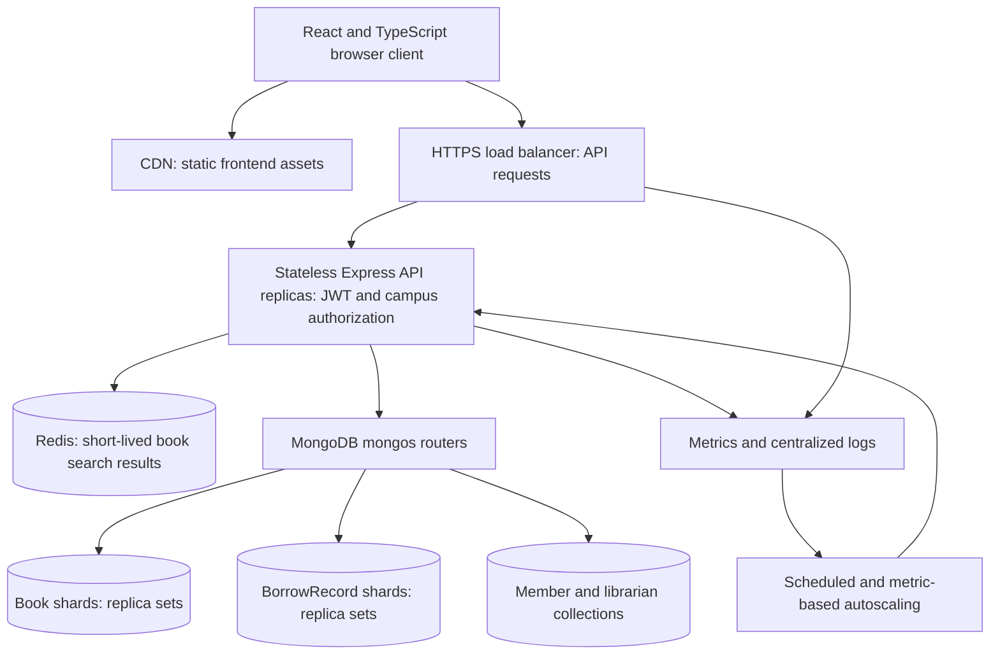

# Q3 — ShelfLife system design (10 marks)

## Assumptions

The network has 500 campus libraries and approximately 2 million members.
Semester week creates 10× normal search and issue/return traffic.
Measure normal request rates, storage size, and latency before capacity selection.
Each book document represents stock at one campus.
Librarian authentication determines campus access.
The components below describe the scale design; they are not assessment application dependencies.

## a) Architecture

The CDN reduces asset latency; the load balancer distributes requests across healthy replicas.
Stateless APIs allow horizontal scaling. Redis reduces repeated search work.
MongoDB controls stock and loans. Replica sets provide failover and transactions.
Verify backup restoration. Omit a queue because issue and return require immediate results.

## b) Database placement and shard keys

Use one logical MongoDB deployment. Benchmark a replica set first.
Shard when measured capacity requires it; member count alone does not establish that need.

| Collection | Proposed shard key | Reason and limitation |
|---|---|---|
| Book | `{ campusId: 1, ISBN: 1 }` | Campus filters target a shard subset. ISBN adds distribution within a large campus. |
| BorrowRecord | `{ campusId: 1, book: 1, _id: 1 }` | Campus and book identify stock-related loans. `_id` permits splitting a large loan history. |

These ranged compound keys permit splitting within a campus.
Campus-only keys cannot divide one large campus's records.
Monitor uneven load; increasing `_id` values can concentrate inserts for a popular book.

Add `campusId` to all entities and librarian authorization data at scale.
Scope every operation to the authorized campus. Reject cross-campus loans.
Use a unique `{ campusId: 1, ISBN: 1 }` Book index.
Document the migration from assessment-wide to campus-wide ISBN uniqueness.
Add a history index on `{ campusId: 1, member: 1, issueDate: -1 }`.
A member-history query can contact multiple shards within its campus.
Books and loans can occupy different shards, requiring distributed transactions.
Shard-key prefixes support targeted queries. See [MongoDB sharding guidance](https://www.mongodb.com/docs/manual/sharding/).

## c) Most read-heavy operation and caching

Book search/listing is the most read-heavy operation under the stated workload.
Cache filtered, paginated results in Redis for **30 seconds**.
Include campus, normalized title query, genre, page, limit, and catalog generation in each key.
Vary expiration slightly to reduce simultaneous cache misses.

Increment the campus catalog generation after committed book creation, issue, or return.
New readers use the new generation; old keys expire.
Earlier searches cannot repopulate the new generation with old results.
The commit-to-invalidation gap permits brief staleness. TTL limits staleness after invalidation failure.
Log failures. Bypass unavailable Redis.

Cached availability can be stale. Check MongoDB stock for every issue.
Never authorize from cache data or cache member history publicly.

## d) Concurrent issue guarantee

Use an atomic conditional decrement with `availableCopies > 0`.
Insert the BorrowRecord in the same database transaction.
Use majority commit acknowledgement and driver transaction retries.
Only one concurrent request takes the last copy. Failed loan creation cancels the decrement.
For returns, check `returnDate: null` and restore stock in the same transaction.

The database controls consistency without another lock service.
Optimistic locking still needs a transaction for two documents.
Distributed locks add ownership failures; queues add response delay.
Replica sets and shards support transactions. See [MongoDB transactions](https://www.mongodb.com/docs/manual/core/transactions/).

## e) Semester traffic spike

Schedule extra API capacity before semester week.
Autoscale using CPU, latency, and concurrent requests.
Reduce replicas after a cooldown; retain measured baseline capacity year-round.
Use CDN assets and Redis caching. Load-test at 10× baseline before semester week.
Monitor database latency, connections, cache hits, and transaction retries.
Bound database connection pools. Increase database capacity before the spike when write tests identify a bottleneck.
Rate-limit login and reject excess load with retry responses.
Keep stock checks and transaction guarantees under load.

Submission note: This file is the Q3 written answer.
`SYSTEM_DESIGN.pdf` is the rendered copy with the diagram. It has 2 pages on A4 at 11 pt.
Render the PDF again after each change to this file.
